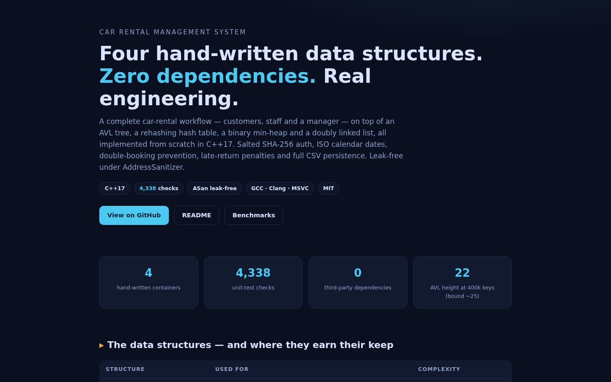
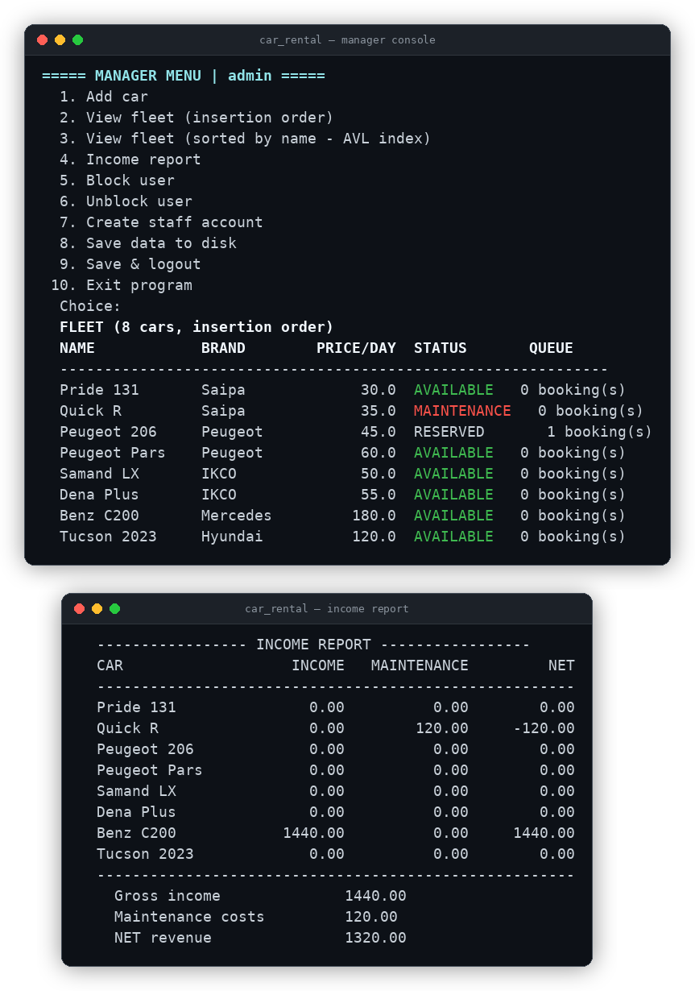

# 🚗 Car Rental Management System — C++17

[](https://github.com/Abolfazlrwm/Car-Rental-System/actions/workflows/ci.yml)
[](https://github.com/Abolfazlrwm/Car-Rental-System/releases)


A complete car-rental workflow (customers, staff, manager) built on
**four hand-written generic data structures** — an AVL tree, a hash table
with rehashing, a binary heap and a doubly linked list. Every container is
implemented from scratch, unit-tested, and documented; the application on
top is a layered, leak-free C++17 console system with real password
hashing, ISO calendar dates, double-booking prevention, late-return
penalties, an audited permission matrix and full CSV persistence.

> Originally written as a data-structures course project, then rebuilt
> into a portfolio-grade repository. Release-by-release history lives in
> the [changelog](CHANGELOG.md); the full v1.0 → v2.0 rebuild story —
> fixed segfaults, memory leaks, an income double-count and more — is
> told in [`docs/IMPROVEMENTS.md`](docs/IMPROVEMENTS.md).

There is also a live landing page, deployed automatically on every push:
**[abolfazlrwm.github.io/Car-Rental-System](https://abolfazlrwm.github.io/Car-Rental-System/)**



---

## 🏗 Architecture


```
mainApp.cpp (Console UI)      role menus · input guards · colored tables
        │
RentalManager (Facade)        business rules · invoicing · persistence
        │
basic_structures/ (Templates) AVLTree<K,V> · HashTable<K,V> ·
                              PriorityQueue<T> · DoublyLinkedList<T>
```

### The data structures — and where they earn their keep

| Structure | Used for | Key operations | Complexity |
|-----------|----------|----------------|------------|
| `AVLTree<K,V>` | car index by name | insert, find, in-order (sorted fleet view) | O(log n) guaranteed |
| `HashTable<K,V>` | username index | insert, find, remove, **auto-rehash at load factor 0.75** | O(1) average |
| `PriorityQueue<T>` | per-car booking schedule | insert, peek, extractMin — earliest pickup served first | O(log n) |
| `DoublyLinkedList<T>` | insertion-order fleet list | push front/back, remove, traversal | O(1) push |

All four are **header-only templates** with injectable comparators and an
explicit ownership model (`ownsValues`), covered by 4,500+ assertions —
including the worst-case test: inserting 500 ascending keys into the AVL
tree and asserting the height stays within the theoretical bound.

---

## ✨ Features

**Accounts & security**
- Customer self-registration; Manager creates Staff/Manager accounts
- **Salted SHA-256** password storage (implemented from scratch, verified
  against official NIST test vectors)
- Auto-block after 3 failed logins, Manager can unblock
- **Permission matrix** (v2.5.0): manager / staff / customer rights
  enforced by the facade itself — staff cannot manage accounts or
  export reports, and every denial is audited
- **Append-only audit trail** (v2.5.0): logins, privileged actions
  and denials round-trip through `data/audit_log.csv`; the manager
  menu lists the newest entries (denials in red)

**Fleet & reservations**
- Car lifecycle: `AVAILABLE → RESERVED → RENTED → MAINTENANCE`
- **Real calendar dates** (`YYYY-MM-DD`) across bookings, returns and
  maintenance logs — strict validation with leap years; pre-2.3.0
  day-number data files still load
- Double-booking prevention (date-range overlap rejection)
- Earliest-pickup-first scheduling (priority queue + FIFO tie-break)
- Rental renewal with queue discipline (blocked when others wait)
- Case-insensitive **keyword search** across car names and brands

**Money & reporting**
- Automatic invoicing: duration × daily price
- **Late-return penalty**: 1.5 × daily rate per late day
- Customer balances with one-tap bill payment
- Income report per car + net revenue (income − maintenance costs)
- **Fleet statistics snapshot**: composition, utilization %, net
  revenue and the top-earning car in one screen
- **One-click CSV reports**: name-sorted fleet sheet + live bookings
  by start date, written to `reports/*.csv` for spreadsheets
- **One-file JSON export**: `reports/report.json` (stats + fleet +
  bookings) with strict RFC 8259 escaping, validated by the suite's
  own JSON parser
- **Fleet analytics dashboard**: ASCII bar charts — composition, rate
  buckets, bookings per car, the next pickups and overdue returns

**Maintenance**
- Send to / return from maintenance, blocked while rented
- Queryable history log with date, description and cost

**Persistence**
- Full state round-trip: users (salted hashes, balances, blocked flags),
  cars (status, income) and **live reservations** in `data/*.csv`
- Auto-seeded demo fleet on first run — clone, build, and it just works

---

## 🎬 Demo



Reserve the Benz → staff delivers it → customer returns it 2 days late →
the manager sees the penalty on the books:

```text
$ ./scripts/demo.sh

===== CUSTOMER MENU | ali | balance due: 0.00 =====
  Choice:   Car name:   Start date (YYYY-MM-DD):   End date   (YYYY-MM-DD):
  Reservation confirmed! Pay on delivery.

  YOUR RESERVATIONS
  #1 | Benz C200        | 2026-11-05 -> 2026-11-09 (5 day(s))

===== STAFF MENU | sara =====
  Choice:   Car name:   Car handed over. Drive safe!
  Choice:   Car name:   Actual return date (YYYY-MM-DD):   Return processed and invoiced.

===== MANAGER MENU | admin =====
  ----------------- INCOME REPORT -----------------
  CAR                   INCOME   MAINTENANCE         NET
  ------------------------------------------------------
  Pride 131               0.00          0.00        0.00
  ...
  Benz C200            1440.00          0.00     1440.00   <- 5x180 + 2 late days x 1.5x180
  ------------------------------------------------------
    Gross income              1440.00
    NET revenue               1440.00
```

Run it yourself:

```bash
./scripts/demo.sh          # scripted end-to-end walkthrough
```

**Demo accounts** (auto-seeded on first run):

| Role | Username | Password |
|------|----------|----------|
| Manager | `admin` | `manager123` |
| Staff | `sara` | `staff123` |
| Customer | `ali` | `customer123` |

---

## 🚀 Build & Run

**Requirements:** a C++17 compiler (GCC ≥ 8, Clang ≥ 8, MSVC 2019+)

### Option 1 — Make (quickest)

```bash
make            # builds car_rental + unit_tests
./car_rental    # start the app
make test       # run the unit tests
```

### Option 2 — CMake

```bash
cmake -B build -DCMAKE_BUILD_TYPE=Release
cmake --build build -j
ctest --test-dir build --output-on-failure
./build/car_rental
```

### Option 3 — one-liner

```bash
g++ -std=c++17 -O2 mainApp.cpp manager_system/*.cpp -o car_rental && ./car_rental
```

On first start the app seeds the demo fleet and accounts; all state is
saved to `data/` on exit and reloaded on the next run.

Non-interactive queries never touch `data/`: `./car_rental --version`
prints the version banner and `--help` lists the flags.

---

## 📁 Project structure

```
Car-Rental-System/
├── mainApp.cpp              # console UI: menus, input guards, colors
├── manager_system/          # business layer
│   ├── RentalManager.{h,cpp}# facade: rules, invoicing, persistence
│   ├── Analytics.{h,cpp}    # dashboard maths (pure, unit-tested)
│   ├── JsonExport.{h,cpp}   # RFC 8259 report writer + escaper
│   ├── AuditLog.{h,cpp}     # append-only trail + CSV round-trip
│   ├── Permissions.h        # the 7-permission role matrix
│   ├── User.{h,cpp}         # User → Customer / Staff / Manager
│   ├── Car.{h,cpp}          # status, income ledger, maintenance log
│   ├── Reservation.{h,cpp}  # booking + priority rule
│   ├── Date.{h,cpp}         # ISO calendar layer (leap years included)
│   └── SHA256.{h,cpp}       # FIPS 180-4, dependency-free
├── basic_structures/        # hand-written generic containers (header-only)
│   ├── AVLTree.h            # self-balancing BST (LL/RR/LR/RL rotations)
│   ├── HashTable.h          # separate chaining + rehashing
│   ├── PriorityQueue.h      # binary min-heap, auto-growing
│   └── DoublyLinkedList.h   # O(1) pushes at both ends
├── tests/test_main.cpp      # 4,542 checks, dependency-free framework
├── scripts/demo.sh          # scripted end-to-end walkthrough
├── benchmarks/
│   └── bench_containers.cpp # `make bench` — ours vs std, measured
├── docs/
│   ├── USAGE.md             # every role's menu, step by step
│   ├── DATA_FORMATS.md      # layout of data/*.csv and reports/*.csv
│   ├── BENCHMARKS.md        # measured numbers + honest analysis
│   ├── IMPROVEMENTS.md      # the v1.0 → v2.0 rebuild story
│   ├── architecture.png     # diagram used above
│   ├── manager_dashboard.png# screenshot used above
│   └── landing.png          # landing-page screenshot used above
├── docs-site/               # GitHub Pages landing page (auto-deployed)
├── .devcontainer/           # one-click contributor container (v2.5.0)
├── CHANGELOG.md             # version-by-version history
├── CONTRIBUTING.md / SECURITY.md / CODE_OF_CONDUCT.md
├── CMakeLists.txt / Makefile / .clang-format
└── .github/                 # CI workflow, templates, dependabot
```

---

## 🧪 Testing

The suite needs no external framework and runs in milliseconds:

```text
==== Car Rental System — unit tests ====
  [ ok ] SHA256 + password hashing
  [ ok ] DoublyLinkedList
  [ ok ] PriorityQueue
  [ ok ] AVLTree (self-balancing)
  [ ok ] HashTable (chaining + rehash)
  [ ok ] Reservation rules
  [ ok ] Date utilities (ISO + serial days)
  [ ok ] RentalManager: accounts & lockout
  [ ok ] RentalManager: reservations & invoices
  [ ok ] RentalManager: fleet & maintenance
  [ ok ] RentalManager: fleet filters
  [ ok ] RentalManager: keyword search
  [ ok ] RentalManager: statistics
  [ ok ] RentalManager: CSV reports
  [ ok ] JSON escaping
  [ ok ] JSON report export
  [ ok ] Fleet analytics dashboard
  [ ok ] RentalManager: CSV persistence
  [ ok ] Role hierarchy
  [ ok ] Permissions: role matrix
  [ ok ] AuditLog: recording & CSV round-trip
  [ ok ] RBAC enforcement at the facade

4542 checks, 0 failure(s)
ALL TESTS PASSED
```

Notable regression tests — each one reproduces a bug that existed in
v1.0: segfault on unknown login, income double-count, fake renewal,
self-registered managers, silent drops on a full heap.

Memory safety is verified with `g++ -fsanitize=address,undefined`.

---

## 🗺 Roadmap

- [x] Real calendar dates — strict `YYYY-MM-DD` across the app (v2.3.0)
- [x] JSON export in addition to CSV — one `reports/report.json`
  holding stats, fleet and bookings (v2.4.0)
- [x] Fleet analytics dashboard — live ASCII bars in the manager menu
  (v2.4.0)
- [ ] Text-based UI using ncurses (windows, colors, arrow-key navigation)
- [x] Fine-grained permissions + an append-only audit trail,
  enforced inside the facade (v2.5.0)
- [x] Docker devcontainer for one-click contributor setup (v2.5.0)

## 📚 Documentation

- [Changelog](CHANGELOG.md) — what every release added, fixed and changed
- [Usage guide](docs/USAGE.md) — every role's menu, step by step
- [CSV data formats](docs/DATA_FORMATS.md) — the exact layout of `data/*.csv` and `reports/*.csv`
- [Benchmarks](docs/BENCHMARKS.md) — the hand-written containers vs `std`, measured
- [Docs site](https://abolfazlrwm.github.io/Car-Rental-System/) — the landing page rendered
- [Contributing](CONTRIBUTING.md) · [Security policy](SECURITY.md) · [Code of conduct](CODE_OF_CONDUCT.md)

## 🤝 Contributing

Issues and PRs are welcome — see the [contributing guide](CONTRIBUTING.md).
The test suite keeps refactors safe: run `make test` before pushing,
and `make asan` if you touch memory management.

## 📄 License

[MIT](LICENSE)
