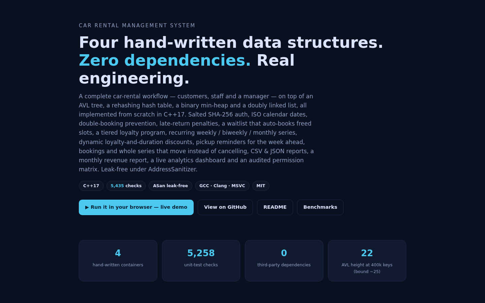
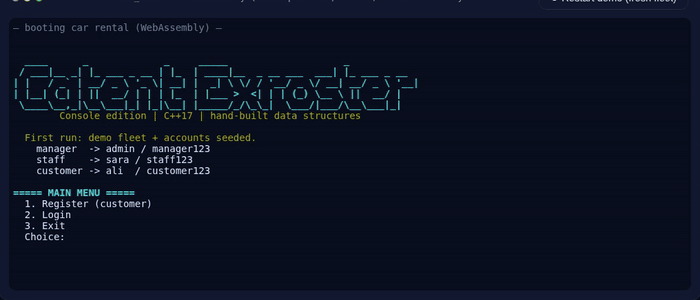
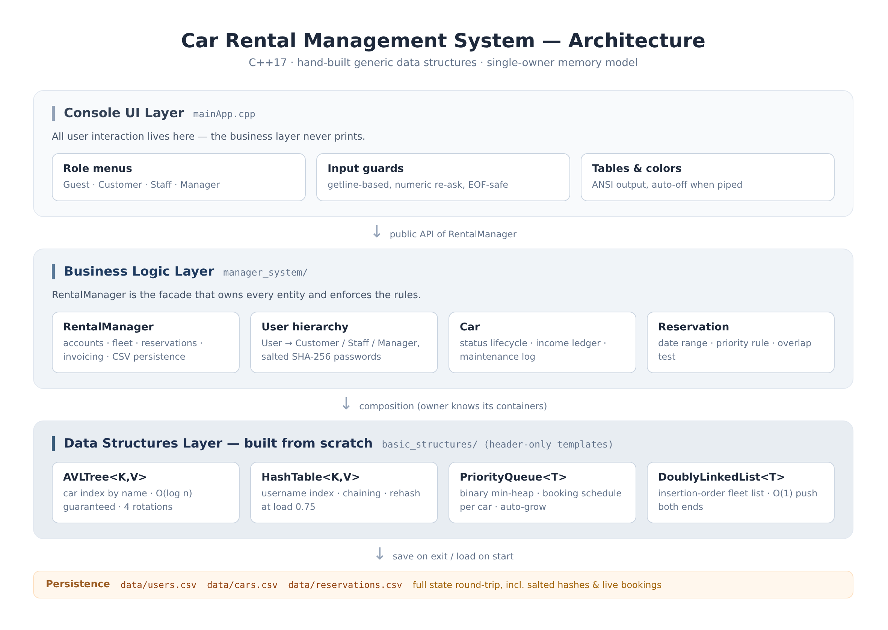
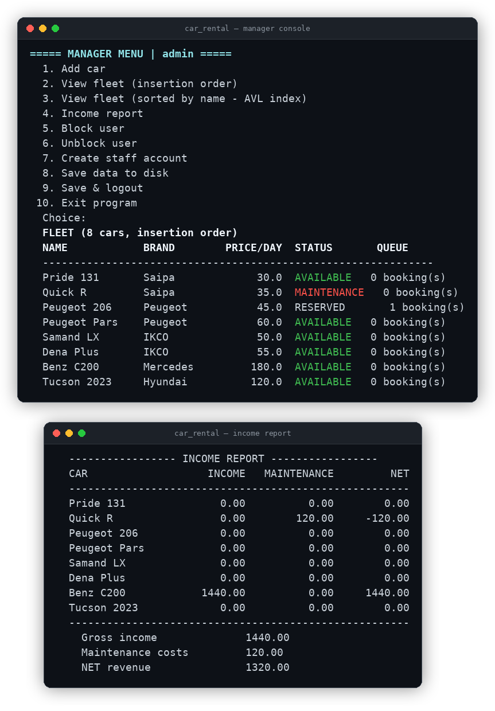
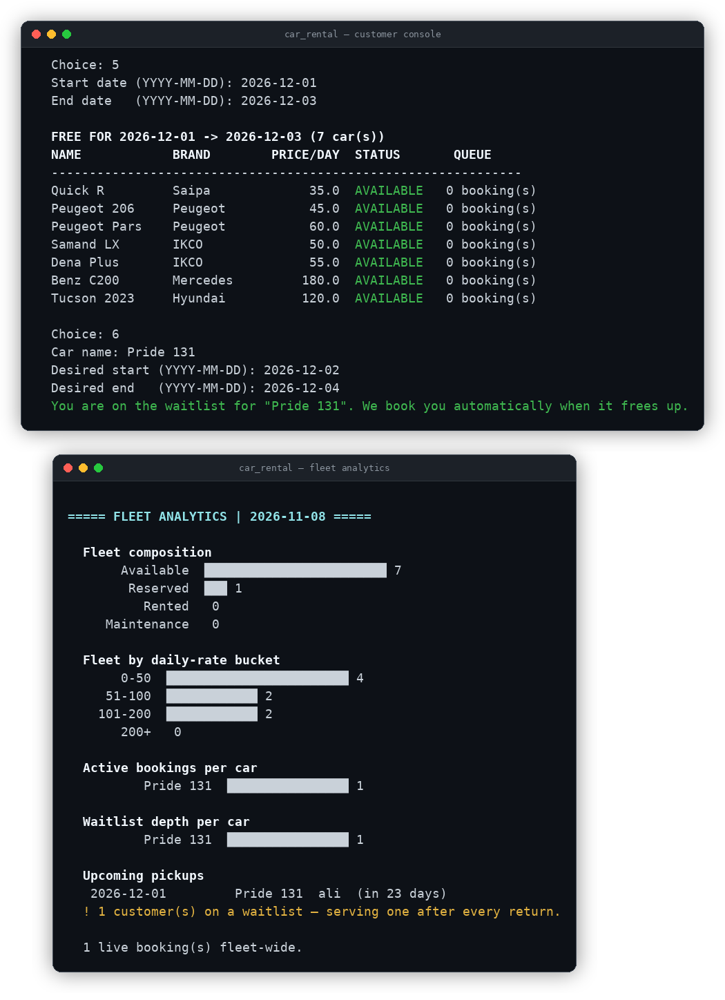
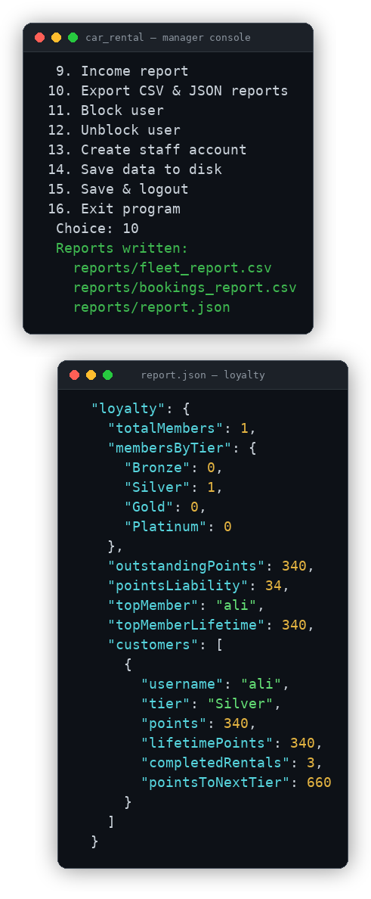
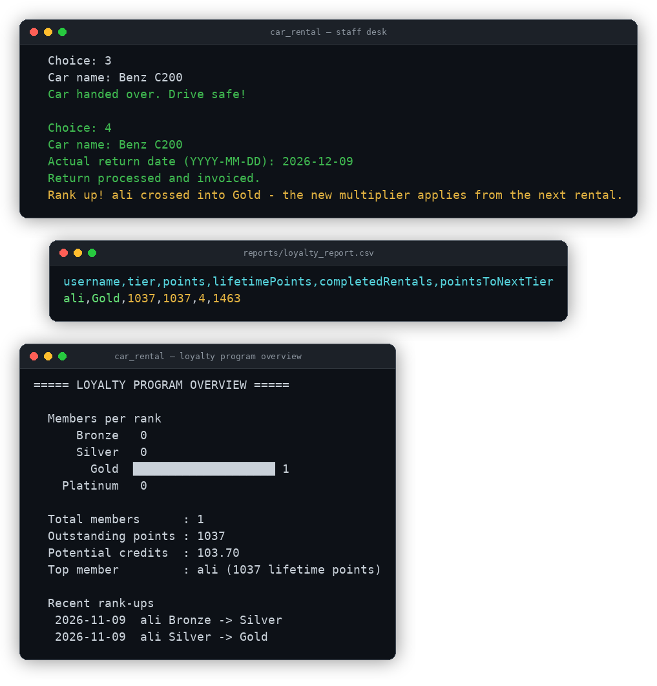
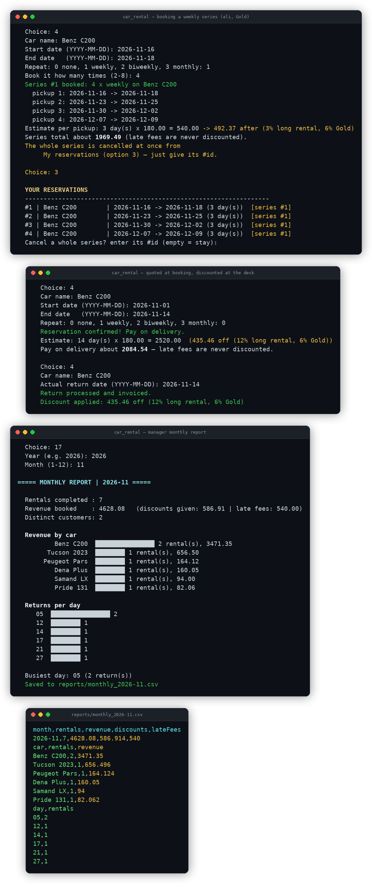
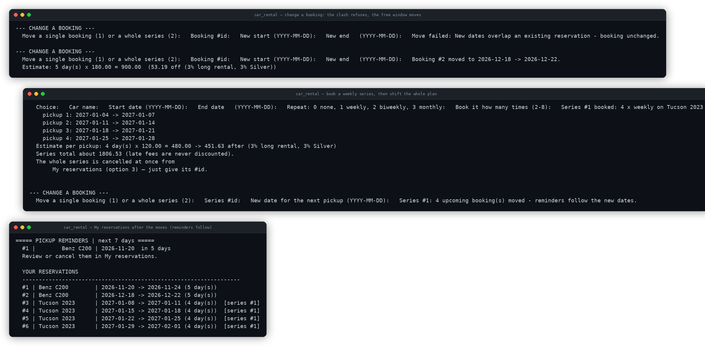

# 🚗 Car Rental Management System — C++17

[](https://github.com/Abolfazlrwm/Car-Rental-System/actions/workflows/ci.yml)
[](https://github.com/Abolfazlrwm/Car-Rental-System/releases)


A complete car-rental workflow (customers, staff, manager) built on
**four hand-written generic data structures** — an AVL tree, a hash table
with rehashing, a binary heap and a doubly linked list. Every container is
implemented from scratch, unit-tested, and documented; the application on
top is a layered, leak-free C++17 console system with real password
hashing, ISO calendar dates, double-booking prevention, late-return
penalties, a waitlist that auto-books freed slots, a tiered loyalty
program, an audited permission matrix and full CSV persistence.

> Originally written as a data-structures course project, then rebuilt
> into a portfolio-grade repository. Release-by-release history lives in
> the [changelog](CHANGELOG.md); the full v1.0 → v2.0 rebuild story —
> fixed segfaults, memory leaks, an income double-count and more — is
> told in [`docs/IMPROVEMENTS.md`](docs/IMPROVEMENTS.md).

There is also a live landing page, deployed automatically on every push:
**[abolfazlrwm.github.io/Car-Rental-System](https://abolfazlrwm.github.io/Car-Rental-System/)**



**Contents** — [Live demo](#-run-it-in-your-browser--live-demo) ·
[Architecture](#-architecture) · [Features](#-features) ·
[Demo](#-demo) · [Build & Run](#-build--run) ·
[Project structure](#-project-structure) · [Testing](#-testing) ·
[Roadmap](#-roadmap) · [Documentation](#-documentation) ·
[Contributing](#-contributing) · [License](#-license)

## 🌐 Run it in your browser — live demo

No clone, no compiler, no install: the landing page's **[live demo](https://abolfazlrwm.github.io/Car-Rental-System/demo.html)**
compiles the same `mainApp.cpp` + `manager_system/*.cpp` to WebAssembly
(Emscripten) and runs the *real* binary in your tab — same menus, same
hand-built AVL tree, hash table, priority queue, same audit trail —
against an in-memory fleet that seeds itself on load. Log in as
`ali / customer123` (customer), `sara / staff123` (staff) or
`admin / manager123` (manager). The desktop build only swaps the input
backend of `readLine`; everything else is the exact same code. New in
v3.4.0 — the **▶ Auto-play demo** button plays a narrated full shift by
itself, no typing: it starts the program with the same `--demo` flag
the desktop binary takes.

<p align="center"></p>
<p align="center"><sub>▲ One full shift, recorded live in the browser demo — book → change → deliver → late return → manager reports</sub></p>


---

## 🏗 Architecture



```
mainApp.cpp (Console UI)      role menus · input guards · colored tables
        │
RentalManager (Facade)        business rules · invoicing · persistence
        │
basic_structures/ (Templates) AVLTree<K,V> · HashTable<K,V> ·
                              PriorityQueue<T> · DoublyLinkedList<T>
```

### The data structures — and where they earn their keep

| Structure | Used for | Key operations | Complexity |
|-----------|----------|----------------|------------|
| `AVLTree<K,V>` | car index by name | insert, find, in-order (sorted fleet view) | O(log n) guaranteed |
| `HashTable<K,V>` | username index | insert, find, remove, **auto-rehash at load factor 0.75** | O(1) average |
| `PriorityQueue<T>` | per-car booking schedule | insert, peek, extractMin — earliest pickup served first | O(log n) |
| `DoublyLinkedList<T>` | insertion-order fleet list | push front/back, remove, traversal | O(1) push |

All four are **header-only templates** with injectable comparators and an
explicit ownership model (`ownsValues`), covered by 4,500+ assertions —
including the worst-case test: inserting 500 ascending keys into the AVL
tree and asserting the height stays within the theoretical bound.

---

## ✨ Features

**Accounts & security**
- Customer self-registration; Manager creates Staff/Manager accounts
- **Salted SHA-256** password storage (implemented from scratch, verified
  against official NIST test vectors)
- Auto-block after 3 failed logins, Manager can unblock
- **Permission matrix** (v2.5.0): manager / staff / customer rights
  enforced by the facade itself — staff cannot manage accounts or
  export reports, and every denial is audited
- **Append-only audit trail** (v2.5.0): logins, privileged actions
  and denials round-trip through `data/audit_log.csv`; the manager
  menu lists the newest entries (denials in red)

**Fleet & reservations**
- Car lifecycle: `AVAILABLE → RESERVED → RENTED → MAINTENANCE`
- **Real calendar dates** (`YYYY-MM-DD`) across bookings, returns and
  maintenance logs — strict validation with leap years; pre-2.3.0
  day-number data files still load
- Double-booking prevention (date-range overlap rejection)
- Earliest-pickup-first scheduling (priority queue + FIFO tie-break)
- **Date-range availability search** (v2.6.0): "which cars are free
  2026-12-01 → 2026-12-03?" answered in one screen
- **Waitlist with auto-booking** (v2.6.0): when your dates are taken,
  file a wish into the car's own priority queue — the facade turns the
  best-fitting wish into a real reservation the moment a return frees
  the window (or maintenance ends), FCFS tie-break, wishes persisted
  in `data/waitlist.csv`
- Rental renewal with queue discipline (blocked when others wait)
- Case-insensitive **keyword search** across car names and brands
- **Recurring reservations** (v3.0.0): book once and repeat — weekly,
  biweekly or monthly plans for 2–8 occurrences of the same car and
  duration, created atomically (a mid-series clash books nothing and
  names the offending occurrence); monthly pickups stay anchored to
  the first day of month with clamping (Jan 31 → Feb 28, Mar 31…);
  cancel the still-queued occurrences in one step from My
  reservations; series tags persist in `reservations.csv`
  (pre-3.0.0 files still load)
- **Pickup reminders** (v3.1.0): signing in and opening My
  reservations both print a `PICKUP REMINDERS | next 7 days` block
  when pickups are due — soonest first, phrased the way the desk
  would say it (`today`, `tomorrow`, `in N days`), each line with
  the booking id, the car, the pickup day and the `[series #id]`
  tag; the rental that is out right now never reminds, and
  cancelling a series clears its reminders in one step
- **Change a booking** (v3.2.0): option 13 moves plans instead of
  cancelling them — one booking to a new window, or a whole series
  shifted in one step with its plan spacing kept; the schedule is
  re-checked with the booking lifted out first (its old slot never
  blocks its own new dates), a series move is atomic and names the
  clashing occurrence, the rental that is out right now cannot
  move, and a refusal leaves everything untouched; the price is
  re-quoted with the current rank and the reminders follow the new
  dates on their own

**Money & reporting**
- Automatic invoicing with **dynamic discounts** (v3.0.0): the booked
  duration earns a long-rental rate (3+ days 3%, 7+ days 7%, 14+ days
  12%, 30+ days 18%) and the loyalty rank earns another (Silver 3%,
  Gold 6%, Platinum 10%) — the two stack multiplicatively, late fees
  stay at the raw daily rate and are never discounted; the booking
  screen quotes the same engine before you owe anything, and a
  discounted return announces the amount at the desk (`discount.applied`
  in the trail); points accrue on the invoiced (discounted) total
- **Late-return penalty**: 1.5 × daily rate per late day
- Customer balances with one-tap bill payment
- **Loyalty program** (v2.7.0): Bronze → Silver → Gold → Platinum
  ranks on lifetime points; every completed rental pays 1 point per
  10.00 spent × the rank's multiplier (up to ×2.0 at Platinum); points
  redeem against the outstanding bill at 10 points = 1.00 (min 50,
  steps of 10, never above the bill — points are spent, not cashed);
  customer loyalty card, manager program overview, counters persisted
  in `users.csv` (pre-2.7.0 files still load), standings exported in
  `report.json` (v2.8.0) and `loyalty_report.csv` (v2.9.0); rank-ups
  announced at the desk, audited, and listed on the program overview
  (v2.9.0)
- Income report per car + net revenue (income − maintenance costs)
- **Fleet statistics snapshot**: composition, utilization %, net
  revenue and the top-earning car in one screen
- **One-click CSV reports**: name-sorted fleet sheet + live bookings
  by start date, written to `reports/*.csv` for spreadsheets
- **One-file JSON export**: `reports/report.json` (stats + fleet +
  bookings + the loyalty program) with strict RFC 8259 escaping,
  validated by the suite's own JSON parser
- **Rental history ledger + monthly report** (v3.0.0): every processed
  return lands in `data/rental_history.csv` with its full invoice
  breakdown; manager option 17 turns it into the month at a glance —
  rentals completed, revenue booked with the discounts/late-fee split,
  distinct customers, revenue by car and returns per day as ASCII
  bars, the busiest day — and writes `reports/monthly_YYYY-MM.csv`
- **Fleet analytics dashboard**: ASCII bar charts — composition, rate
  buckets, bookings per car, waitlist depth per car, the next pickups
  and overdue returns

**Maintenance**
- Send to / return from maintenance, blocked while rented
- Queryable history log with date, description and cost

**Persistence**
- Full state round-trip: users (salted hashes, balances, blocked flags,
  loyalty counters), cars (status, income), **live reservations** and
  the **waitlist** in `data/*.csv`
- Auto-seeded demo fleet on first run — clone, build, and it just works

---

## 🎬 Demo



New in v2.6.0 — the waitlist: search what is free for an exact range,
file a wish on the booked car, and the analytics dashboard shows the
queue depth per car:



New in v2.7.0 — the loyalty program: completed rentals pay points at
the rank's multiplier, ranks grow on lifetime points, and points turn
into bill credits:

```text
===== LOYALTY CARD | ali =====

  Rank: Silver
   ███  660 points to Gold
  Points available  : 340
  Lifetime points   : 340
  Completed rentals : 3
  Earning rate      : x1.25 - 1 point per 10.00 spent, credited on return
  Redemption        : 10 points = 1.00 off your bill (min 50, steps of 10)
```

New in v2.8.0 — the same export writes the loyalty standings into
`reports/report.json` (stats + fleet + bookings + loyalty):



New in v2.9.0 — a return that crosses a rank threshold is announced at
the desk, audited, and pinned on the program overview; the same export
writes `reports/loyalty_report.csv` (one username-sorted row per
customer):



New in v3.0.0 — recurring reservations, dynamic discounts and the monthly
report: book a weekly series in one go (atomic, with a per-pickup estimate
and a series total), watch the long-rental × rank discount stack at booking
and again at the desk, and read the month's revenue, per-car bars and the
busiest day on one manager screen:



New in v3.1.0 & v3.2.0 — pickup reminders and change a booking: opening
My reservations prints the week's pickups the way the desk would say them,
and when plans change, option 13 moves ONE booking to new dates (the
schedule is re-checked with the booking lifted out first and the price is
re-quoted) or shifts a WHOLE series in one step — every refused move leaves
everything untouched and says why:



Reserve the Benz → staff delivers it → customer returns it 2 days late →
the manager sees the penalty on the books:

```text
$ ./scripts/demo.sh

===== CUSTOMER MENU | ali | balance due: 0.00 =====
  Choice:   Car name:   Start date (YYYY-MM-DD):   End date   (YYYY-MM-DD):
  Reservation confirmed! Pay on delivery.

  YOUR RESERVATIONS
  #1 | Benz C200        | 2026-11-05 -> 2026-11-09 (5 day(s))

===== STAFF MENU | sara =====
  Choice:   Car name:   Car handed over. Drive safe!
  Choice:   Car name:   Actual return date (YYYY-MM-DD):   Return processed and invoiced.

===== MANAGER MENU | admin =====
  ----------------- INCOME REPORT -----------------
  CAR                   INCOME   MAINTENANCE         NET
  ------------------------------------------------------
  Pride 131               0.00          0.00        0.00
  ...
  Benz C200            1440.00          0.00     1440.00   <- 5x180 + 2 late days x 1.5x180
  ------------------------------------------------------
    Gross income              1440.00
    NET revenue               1440.00
```

Run it yourself:

```bash
./scripts/demo.sh          # scripted end-to-end walkthrough
```

**Demo accounts** (auto-seeded on first run):

| Role | Username | Password |
|------|----------|----------|
| Manager | `admin` | `manager123` |
| Staff | `sara` | `staff123` |
| Customer | `ali` | `customer123` |

---

## 🚀 Build & Run

**Requirements:** a C++17 compiler (GCC ≥ 8, Clang ≥ 8, MSVC 2019+)

### Option 1 — Make (quickest)

```bash
make            # builds car_rental + unit_tests
./car_rental    # start the app
make test       # run the unit tests
make coverage   # unit-test coverage report (needs gcovr)
make wasm       # compile the browser demo (needs Emscripten)
make wasm-test  # run the browser binary end-to-end in Node
```

### Option 2 — CMake

```bash
cmake -B build -DCMAKE_BUILD_TYPE=Release
cmake --build build -j
ctest --test-dir build --output-on-failure
./build/car_rental
```

### Option 3 — one-liner

```bash
g++ -std=c++17 -O2 mainApp.cpp manager_system/*.cpp -o car_rental && ./car_rental
```

### Option 4 — Docker (nothing to install but Docker itself)

```bash
docker run -it ghcr.io/abolfazlrwm/car-rental-system
```

Keep your fleet between runs by mounting a volume for `data/`:

```bash
docker run -it -v "$PWD/data:/workspace/data" ghcr.io/abolfazlrwm/car-rental-system
```

Images are multi-arch (`amd64` + `arm64`), tagged `latest` and per
release, and pushed to GHCR by CI on every push and tag
([`.github/workflows/docker.yml`](.github/workflows/docker.yml)).

On first start the app seeds the demo fleet and accounts; all state is
saved to `data/` on exit and reloaded on the next run.

Non-interactive queries never touch `data/`: `./car_rental --version`
prints the version banner and `--help` lists the flags. Plain output
is available everywhere — `--no-color` for pipes, logs and CI, or a
`NO_COLOR` environment variable ([no-color.org](https://no-color.org)).

**Persian UI (v3.6.0):** `./car_rental --lang fa` switches the whole
interactive layer — menus, prompts, tables, reports — to Persian; the
choice is saved to `data/lang.txt` and reused on the next run
(`--lang en` switches back). The default stays English, and
`--help` / `--version` / the guided demo always speak English so the
CI contract greps stay byte-stable. Use a bidi-capable terminal
(Windows Terminal, GNOME/KDE terminals, iTerm2, Termux) for correct
RTL rendering. By design the domain strings returned by the core
(booking-conflict errors, discount notes, the audit table) stay
English — the unit suite pins their exact bytes.

**PNG reports (v3.7.0 + v3.8.0):** the manager saves three reports as
real images with the dependency-free PNG writer (hand-rolled
CRC32/Adler32, stored-deflate zlib framing, an 8x8 glyph table
rasterised from DejaVu at build time) — no image library anywhere:

- option 18 — the monthly report as `reports/monthly_YYYY-MM.png`
  (figures plus per-car and per-day bars);
- option 19 — the loyalty snapshot as `reports/loyalty_overview.png`
  (totals, top member, members per rank);
- option 20 — the analytics dashboard as `reports/dashboard.png`
  (composition, price buckets, bookings per car, waitlist depth,
  upcoming pickups, chase-ups).

Each render reads the same struct its console screen shows, so image
and screen can never drift apart.

**One consolidated PDF (v3.9.0):** option 21 saves every report as a
single printable `reports/all_reports_YYYY-MM.pdf` — a cover page plus
one full page per report, the pages embedded straight from the same
renderers, xref/trailer hand-rolled: still zero dependencies, and the
bytes are deterministic (no timestamps), so the suite pins them.

**Guided demo:** `./car_rental --demo` plays one narrated, self-running
shift — book → change a booking → deliver → late return with penalty →
manager reports — with dates derived from today's clock, on a fresh
in-memory fleet (`data/` is never read or written). No compiler? The
browser demo's **▶ Auto-play demo** button runs the same walkthrough.

**Downloads:** prebuilt binaries on the
[Releases](https://github.com/Abolfazlrwm/Car-Rental-System/releases)
page — `windows-x64.zip`, `linux-x64.tar.gz`, `linux-arm64.tar.gz`
(static, also for Raspberry Pi-class boards), `macos-arm64.tar.gz`
(Apple Silicon), `macos-x64.tar.gz` (Intel), a **fully static
`android-arm64.tar.gz`** that runs directly on Android/Termux (no
install step), plus `wasm-demo.zip` for offline browser use. No
compiler needed anywhere.

---

## 🌐 REST API (read-only, v3.7.0)

`./car_rental --serve [port]` starts a tiny HTTP server (default
8080, bound to 127.0.0.1 only, hand-rolled on POSIX sockets /
Winsock — still zero dependencies) that exposes the manager's
numbers as JSON:

| Endpoint | Returns |
| --- | --- |
| `GET /health` | liveness + service name |
| `GET /version` | version metadata |
| `GET /cars` | the fleet, name-sorted |
| `GET /cars/{name}` | one car (404 when absent) |
| `GET /cars/{name}/reservations` | live bookings on one car |
| `GET /stats` | FleetStats + waitlist depth |
| `GET /loyalty` | the program snapshot |
| `GET /audit?limit=N` | newest audit entries (1..500) |
| `GET /pickups?days=N` | upcoming pickups (1..30) |
| `GET /monthly?year=Y&month=M` | the monthly report |
| `GET /reports/monthly.png?year=Y&month=M` | the monthly report as PNG (v3.9.0) |
| `GET /reports/loyalty.png` | the loyalty overview as PNG (v3.9.0) |
| `GET /reports/dashboard.png` | the analytics dashboard as PNG (v3.9.0) |
| `GET /reports/all.pdf?year=Y&month=M` | all three reports as one consolidated PDF (v3.9.0) |

```bash
./car_rental --serve 8080 &
curl -s http://127.0.0.1:8080/cars | python3 -m json.tool
curl -s "http://127.0.0.1:8080/monthly?year=2026&month=11"
```

Read-only by design — mutations stay in the TUI where every change
is validated, priced and audited interactively; the router is pure
(unit-tested without sockets), JSON is escaped with the same escaper
the report writer uses, and the WebAssembly build compiles the
router but reports `serve()` unavailable. In Docker, publish the
port to reach it: `docker run -p 8080:8080
ghcr.io/abolfazlrwm/car-rental-system --serve`.

---

## 📁 Project structure

```
Car-Rental-System/
├── mainApp.cpp              # console UI: menus, input guards, colors
├── manager_system/          # business layer
│   ├── RentalManager.{h,cpp}# facade: rules, invoicing, persistence
│   ├── Analytics.{h,cpp}    # dashboard maths (pure, unit-tested)
│   ├── Pricing.h            # dynamic discount engine (pure, unit-tested)
│   ├── Recurring.h          # repeat-booking plans (pure, unit-tested)
│   ├── RentalHistory.{h,cpp}# completed-rentals ledger + CSV round-trip
│   ├── MonthlyReport.{h,cpp}# month aggregation (pure, unit-tested)
│   ├── JsonExport.{h,cpp}   # RFC 8259 report writer + escaper
│   ├── AuditLog.{h,cpp}     # append-only trail + CSV round-trip
│   ├── Permissions.h        # the 7-permission role matrix
│   ├── WaitlistEntry.{h,cpp}# a wish: car + range + FCFS join order
│   ├── User.{h,cpp}         # User → Customer / Staff / Manager
│   ├── Car.{h,cpp}          # status, income ledger, maintenance log
│   ├── Reservation.{h,cpp}  # booking + priority rule
│   ├── Date.{h,cpp}         # ISO calendar layer (leap years included)
│   └── SHA256.{h,cpp}       # FIPS 180-4, dependency-free
│                           # passwords: PBKDF2-HMAC-SHA256 (100k iters,
│                           # CSPRNG 16-byte salt, constant-time compare)
├── basic_structures/        # hand-written generic containers (header-only)
│   ├── AVLTree.h            # self-balancing BST (LL/RR/LR/RL rotations)
│   ├── HashTable.h          # separate chaining + rehashing
│   ├── PriorityQueue.h      # binary min-heap, auto-growing
│   └── DoublyLinkedList.h   # O(1) pushes at both ends
├── tests/test_main.cpp      # 5,471 checks, dependency-free framework
├── scripts/demo.sh          # scripted end-to-end walkthrough
├── benchmarks/
│   └── bench_containers.cpp # `make bench` — ours vs std, measured
├── docs/
│   ├── USAGE.md             # every role's menu, step by step
│   ├── DATA_FORMATS.md      # layout of data/*.csv and reports/*.csv
│   ├── BENCHMARKS.md        # measured numbers + honest analysis
│   ├── IMPROVEMENTS.md      # the v1.0 → v2.0 rebuild story
│   ├── architecture.png     # diagram used above
│   ├── manager_dashboard.png# screenshot used above
│   ├── v3_highlights.png    # screenshot used above
│   └── landing.png          # landing-page screenshot used above
├── docs-site/               # GitHub Pages landing page (auto-deployed)
├── .devcontainer/           # one-click contributor container (v2.5.0)
├── CHANGELOG.md             # version-by-version history
├── CONTRIBUTING.md / SECURITY.md / CODE_OF_CONDUCT.md
├── CMakeLists.txt / Makefile / .clang-format
└── .github/                 # CI workflow, templates, dependabot
```

---

## 🧪 Testing

The suite needs no external framework and runs in milliseconds:

```text
==== Car Rental System — unit tests ====
  [ ok ] SHA256 + password hashing
  [ ok ] DoublyLinkedList
  [ ok ] PriorityQueue
  [ ok ] AVLTree (self-balancing)
  [ ok ] HashTable (chaining + rehash)
  [ ok ] Reservation rules
  [ ok ] Date utilities (ISO + serial days)
  [ ok ] RentalManager: accounts & lockout
  [ ok ] RentalManager: reservations & invoices
  [ ok ] RentalManager: fleet & maintenance
  [ ok ] RentalManager: fleet filters
  [ ok ] RentalManager: keyword search
  [ ok ] RentalManager: statistics
  [ ok ] RentalManager: CSV reports
  [ ok ] JSON escaping
  [ ok ] JSON report export
  [ ok ] JSON report: loyalty standings
  [ ok ] Fleet analytics dashboard
  [ ok ] RentalManager: CSV persistence
  [ ok ] Role hierarchy
  [ ok ] Permissions: role matrix
  [ ok ] AuditLog: recording & CSV round-trip
  [ ok ] RBAC enforcement at the facade
  [ ok ] Waitlist: wish priority rules
  [ ok ] Car waitlist queue
  [ ok ] Waitlist: facade, promotion & persistence
  [ ok ] Loyalty: tiers & maths
  [ ok ] RentalManager: loyalty accrual & redemption
  [ ok ] Loyalty: program overview & legacy rows
  [ ok ] Recurring series: plan maths
  [ ok ] Recurring series: reminder maths
  [ ok ] RentalManager: recurring series
  [ ok ] RentalManager: pickup reminders
  [ ok ] Reschedule: change-of-plans move rules
  [ ok ] RentalManager: change-a-booking flow
  [ ok ] Pricing: dynamic discount maths
  [ ok ] RentalManager: discounted invoices
  [ ok ] RentalHistory: ledger & CSV round-trip
  [ ok ] Monthly report: builder maths
  [ ok ] RentalManager: monthly report flow

5584 checks, 0 failure(s)
ALL TESTS PASSED
```

Notable regression tests — each one reproduces a bug that existed in
v1.0: segfault on unknown login, income double-count, fake renewal,
self-registered managers, silent drops on a full heap.

Memory safety is verified with `g++ -fsanitize=address,undefined`.

**Line coverage: 92%** — measured with gcovr (`make coverage`) over the
`manager_system` modules and headers on a `--coverage` build; the
interactive `mainApp.cpp` console layer is proven separately by the
CLI-contract job (`--help` / `--version` / `--no-color` / unknown
options). CI publishes the full per-file Cobertura report as a build
artifact on every push, alongside the WebAssembly smoke test
(`make wasm-test`) that runs the compiled browser binary through a
scripted session in Node.

---

## 🗺 Roadmap

- [x] Real calendar dates — strict `YYYY-MM-DD` across the app (v2.3.0)
- [x] JSON export in addition to CSV — one `reports/report.json`
  holding stats, fleet and bookings (v2.4.0)
- [x] Fleet analytics dashboard — live ASCII bars in the manager menu
  (v2.4.0)
- [ ] Text-based UI using ncurses (windows, colors, arrow-key navigation)
- [x] Fine-grained permissions + an append-only audit trail,
  enforced inside the facade (v2.5.0)
- [x] Docker devcontainer for one-click contributor setup (v2.5.0)
- [x] Date-range availability search + per-car waitlist that
  auto-books freed slots (v2.6.0)
- [x] Loyalty program — ranks, points and bill credits, derived
  tier with nothing to forget on save (v2.7.0)
- [x] Loyalty standings in the JSON report — program snapshot plus
  per-member rows in `reports/report.json` (v2.8.0)
- [x] Loyalty CSV report + rank-up notifications — desk announcement,
  audited promotions, recent rank-ups on the overview (v2.9.0)
- [x] Recurring reservations — weekly / biweekly / monthly series,
  atomic booking, one-step cancellation (v3.0.0)
- [x] Dynamic discounts — long-rental × rank rates stacked on every
  invoice, quoted at booking, announced at the desk (v3.0.0)
- [x] Rental history ledger + monthly report — revenue, discounts,
  per-car bars and the busiest day, on screen and as CSV (v3.0.0)
- [x] Pickup reminders — the week ahead greets the customer at
  login and above My reservations, series tags included (v3.1.0)
- [x] Change a booking — move one booking or shift a whole series
  in one step, availability re-checked and re-quoted (v3.2.0)

## 📚 Documentation

- [Changelog](CHANGELOG.md) — what every release added, fixed and changed
- [Usage guide](docs/USAGE.md) — every role's menu, step by step
- [CSV data formats](docs/DATA_FORMATS.md) — the exact layout of `data/*.csv` and `reports/*.csv`
- [Benchmarks](docs/BENCHMARKS.md) — the hand-written containers vs `std`, measured
- [Docs site](https://abolfazlrwm.github.io/Car-Rental-System/) — the landing page rendered
- [Contributing](CONTRIBUTING.md) · [Security policy](SECURITY.md) · [Code of conduct](CODE_OF_CONDUCT.md)

## 🤝 Contributing

Issues and PRs are welcome — see the [contributing guide](CONTRIBUTING.md).
The test suite keeps refactors safe: run `make test` before pushing,
and `make asan` if you touch memory management.

## 📄 License

[MIT](LICENSE)
